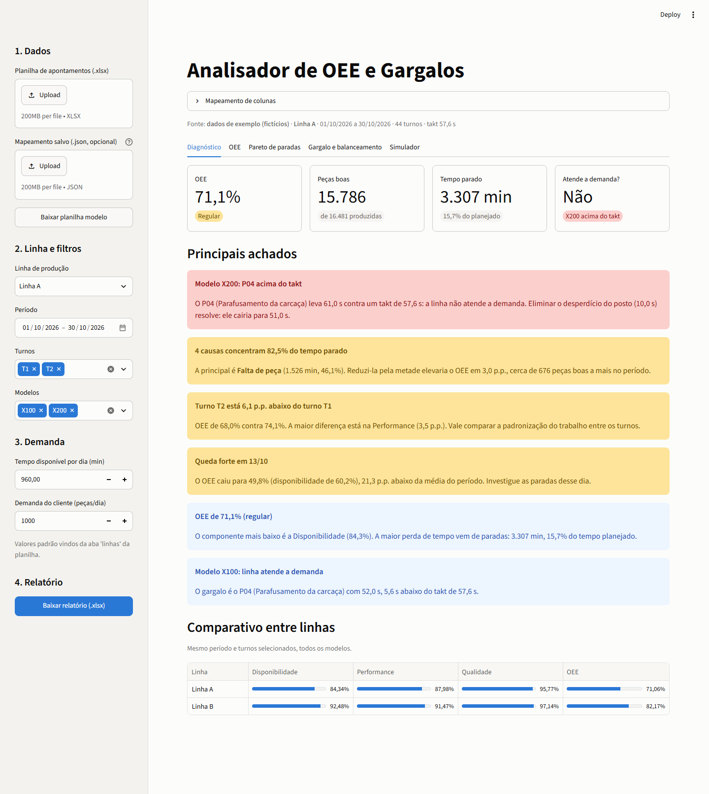
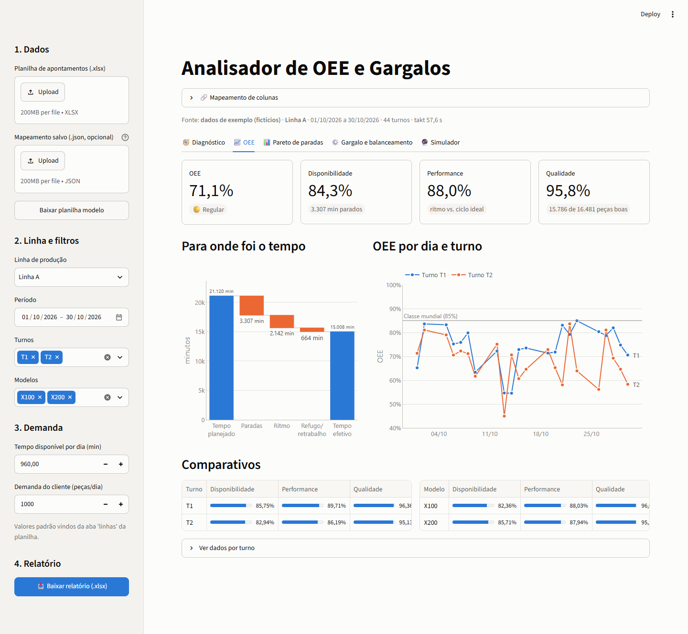
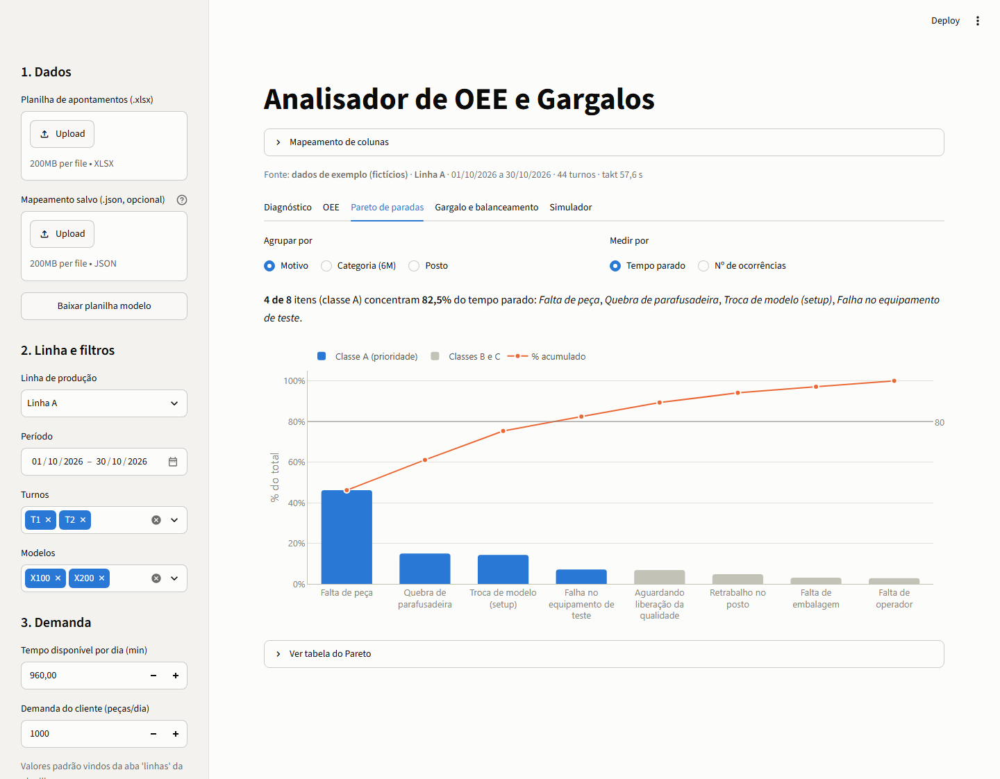
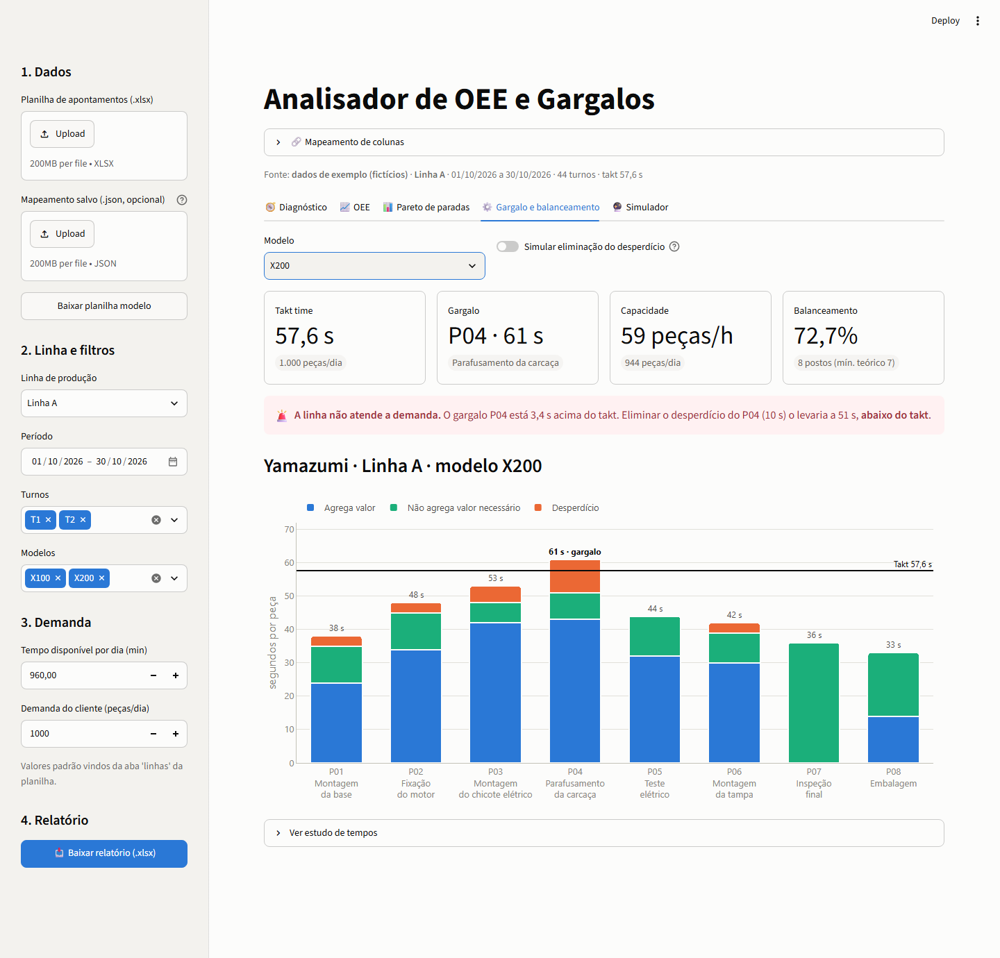
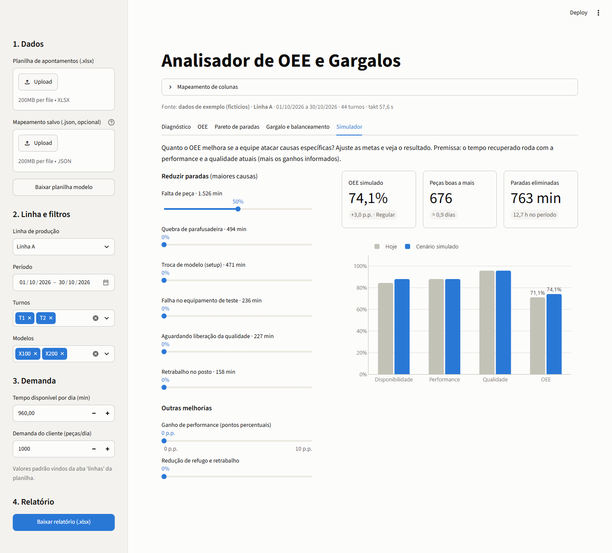

**English** | [Português](README.pt-BR.md)

# OEE and Bottleneck Analyzer · Assembly Line

A Python dashboard that turns an assembly line's production log spreadsheet into a **ready-to-use diagnosis**: OEE breakdown, downtime Pareto, bottleneck vs. takt time (Yamazumi) and a what-if simulator that translates improvements into **additional good parts**.

**[Open the live app](https://oee-montagem.streamlit.app)** · 100% fictitious data, generated by script · the interface is in Brazilian Portuguese



---

## The problem

In many plants, OEE is calculated by hand in a spreadsheet once a month and reaches the meeting as a single number ("71%"). Nobody knows **where** the loss is or **how much** it is worth fixing. This project automates that path:

> production log → validation → KPIs → root causes → bottleneck → "what if?" → report

## What the app does

| Tab (in the app) | Question it answers |
|---|---|
| **Diagnóstico** (Diagnosis) | What is wrong and where to start? Findings written as plain sentences, sorted by priority (red = critical, yellow = attention). |
| **OEE** | Where did the time go? Waterfall from planned time to effective time, trend by day and shift. |
| **Pareto de paradas** (Downtime Pareto) | Which few causes account for most of the loss? ABC classes by reason, 6M category or workstation. |
| **Gargalo e balanceamento** (Bottleneck and line balancing) | Can the line meet demand? Yamazumi per workstation (value-added / necessary non-value-added / waste) against takt time. The bottleneck is highlighted in red when it exceeds takt and in yellow when it is still within it. |
| **Simulador** (Simulator) | If we cut cause X in half, how much do we gain in OEE and in parts? |
| **Relatório** (Report) | Formatted Excel file with summary, findings, OEE by day/shift, Pareto and Yamazumi, ready for the meeting. |

<table>
<tr>
<td></td>
<td></td>
</tr>
<tr>
<td></td>
<td></td>
</tr>
</table>

### Sample reading (fictitious data, Line A)

- OEE of **71.1%**: Availability 84.3% × Performance 88.0% × Quality 95.8%.
- **Missing parts** account for 46% of downtime. Cutting them in half raises OEE to **74.1%**, which means **+676 good parts** in the month.
- On model **X200**, workstation **P04** takes 61 s against a takt time of 57.6 s, so the line cannot meet demand. Removing the station's 10 s of waste solves it with no investment.
- Shift T2 is 6.1 p.p. below T1, and the gap is in **performance**, which points to standardized work.
- The drop on Oct 13 (a supplier crisis simulated by the data generator) is **detected automatically**.

## How the numbers are calculated

### OEE as a time waterfall

Instead of multiplying loose percentages, the calculation follows time:

| Time | Definition | Index |
|---|---|---|
| Planned | shift − scheduled breaks | |
| Operating | planned − downtime | **Availability** = operating ÷ planned |
| Ideal | parts produced × ideal cycle time | **Performance** = ideal ÷ operating |
| Effective | good parts × ideal cycle time | **Quality** = effective ÷ ideal |

**OEE = Availability × Performance × Quality = effective ÷ planned**

When aggregating several shifts, the app **sums the times first and divides afterwards**. Averaging each shift's percentages distorts the result when shifts have different lengths.

| Range | Rating |
|---|---|
| ≥ 85% | World class |
| ≥ 75% | Good |
| ≥ 65% | Fair |
| < 65% | Critical |

### Takt time, bottleneck and line balancing

- **Takt time** = available time per day (s) ÷ daily demand. It is the pace the customer requires.
- **Bottleneck** = the workstation with the longest cycle time. If it exceeds takt, the line cannot meet demand.
- **Capacity** = 3600 ÷ bottleneck time (parts/h).
- **Line balance efficiency** = sum of station times ÷ (number of stations × bottleneck time).
- **Theoretical minimum stations** = ⌈sum of station times ÷ takt⌉.

### Pareto with ABC classes

Causes are ranked by downtime or by number of occurrences. The class comes from the cumulative percentage **before** each item:
- **A**: starts below 80%
- **B**: starts below 95%
- **C**: everything else

This way the top cause is always class A.

### Simulator assumptions

- Eliminated downtime becomes operating time.
- That time runs at the current performance and quality, plus any gains entered.
- Only the **gained time** is converted into parts, using the period's average cycle time, which respects the product mix.

## Using it with your own plant's spreadsheet

Every plant names its columns differently ("Qtd Produzida", "Célula", "Rework", "Downtime"...). The app **does not require renaming anything**:

1. When the spreadsheet is loaded, the **column mapping** panel tries to recognize each field in three steps:
   1. by exact name;
   2. by a list of shop-floor synonyms;
   3. by similar name, which catches typos.
2. Anything not recognized is shown so you can pick the right column.
3. Save the mapping as `.json`. Next month, just load the new spreadsheet together with that file.

The app also supports **multiple production lines** in the same file: a `linha` (line) column in the sheets and an optional `linhas` sheet with each line's demand and available time. Every spreadsheet goes through **validation with messages that point to the Excel row** (for example: production sheet, rows 14 and 27, scrap + rework greater than parts produced).

### Expected format (after mapping)

Column names are in Portuguese, as the app expects them.

| Sheet | Columns |
|---|---|
| `producao` (production) | data, turno, linha, modelo, tempo_planejado_min, ciclo_ideal_s, pecas_produzidas, pecas_refugo, pecas_retrabalho |
| `paradas` (downtime) | data, turno, linha, posto, motivo, categoria, duracao_min |
| `postos` (workstations) | linha, modelo, posto, nome_posto, operacao, tempo_s, tipo |
| `linhas` (lines, *optional*) | linha, demanda_diaria, tempo_disponivel_min |

A template spreadsheet can be downloaded from the button in the app's sidebar.

## Running locally

```powershell
git clone https://github.com/MiguelVin/analisador-oee-montagem.git
cd analisador-oee-montagem
python -m venv .venv
.\.venv\Scripts\activate          # Linux/Mac: source .venv/bin/activate
pip install -r requirements.txt
streamlit run app.py
```

Generate another fictitious dataset:

```powershell
python dados/gerar_dados.py --inicio 2026-10-01 --fim 2026-10-31 --semente 7
```

Run the tests (68 tests):

```powershell
pytest
```

## Project structure

```
app.py                 Streamlit interface (tabs, filters, simulator, download)
src/
  leitor.py            spreadsheet reading and validation (messages with Excel row numbers)
  mapeamento.py        automatic column recognition (name, synonyms, similarity)
  indicadores.py       OEE as a time waterfall, takt time, aggregations
  pareto.py            Pareto with ABC classes
  gargalo.py           Yamazumi, bottleneck, capacity, line balancing
  simulador.py         what-if scenarios
  diagnostico.py       automatic findings written in shop-floor language
  relatorio.py         Excel export
  graficos.py          Plotly charts (colorblind-safe palette, Brazilian number format)
dados/gerar_dados.py   fictitious data generator with realistic scenarios
tests/                 tests with hand-calculated cases (e.g. 90% × 90% × 90% = 72.9%)
```

## Stack

Python · pandas · Plotly · Streamlit · openpyxl · pytest

## About the data

All data in this repository is **fictitious**, generated by `dados/gerar_dados.py`, with scenarios planted for the diagnosis to find:
- a supplier crisis;
- a shift with lower performance;
- a workstation above takt time.

No real company data was used.

## License

[MIT](LICENSE)
